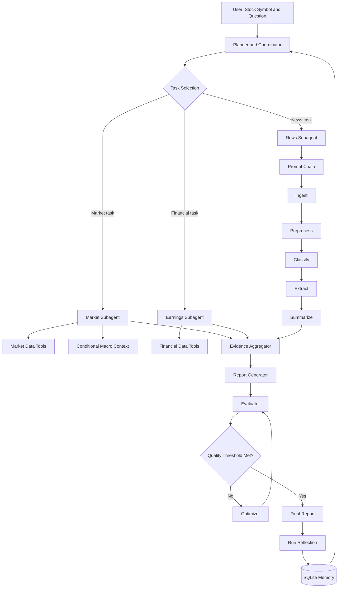

# Agentic AI for Autonomous Investment Research

A Python-based autonomous investment research system that plans research tasks, dynamically selects tools and specialist subagents, analyzes market, financial, and news data, evaluates its own output, improves weak sections, and learns across runs.

## Current Integration Status

All three engineers' work is integrated. Engineer 1's Planner and Orchestrator route each request to the specialists it needs; Engineer 2's data connectors, market and earnings analysis and five-stage news chain produce cited evidence; Engineer 3's report pipeline writes a cited report, runs the Evaluator-Optimizer loop, reflects on the run and stores lessons in SQLite memory that later runs read before planning. `build_runtime()` reports every component as `real`.

The default LLM is Gemini 3.8 Flash through Google AI Studio (`LLM_PROVIDER=gemini`); Groq, Hugging Face and a local Qwen model remain selectable. The notebook demonstrates every requirement on live data. See [Plans/final_completion_plan.md](Plans/final_completion_plan.md) for the completion plan and [Plans/integration_plan.md](Plans/integration_plan.md) for the Engineer 1 and 2 merge.

## Project Objectives

The project demonstrates the following required capabilities.

### Workflow Patterns

1. **Prompt Chaining**
   - Ingest News
   - Preprocess
   - Classify
   - Extract
   - Summarize

2. **Routing**
   - The Planner assigns research tasks to the appropriate specialist subagents.
   - Routing is implemented inside the Planner, so a separate Router Agent is not required.

3. **Evaluator–Optimizer**
   - Generate an initial report.
   - Evaluate the report using a quality rubric.
   - Refine weak sections using evaluator feedback.
   - Re-evaluate until the quality threshold or maximum cycle count is reached.

### Autonomous Agent Functions

1. **Planning**
2. **Dynamic Tool Use**
3. **Self-Reflection**
4. **Learning Across Runs**

## High-Level Architecture



## Repository Structure

```text
AIR-Autonomous_Investment_Research/
├── investment_research_agent.ipynb   end-to-end demonstration (run top to bottom)
├── README.md
├── architecture.md
├── requirements.txt
├── requirements-local-llm.txt        optional, for LLM_PROVIDER=local
├── .env.example
├── Plans/
│   ├── prd_and_engineer_plans.md
│   ├── engineer_1_plan.md, engineer_2_plan.md, engineer_3_plan.md
│   ├── integration_plan.md
│   └── final_completion_plan.md
├── src/
│   ├── config.py, models.py, utils.py
│   ├── llm_client.py, llm_cache.py, local_llm.py
│   ├── planner.py, orchestrator.py, tool_registry.py, bootstrap.py, stubs.py
│   ├── data_tools.py, macro_context.py, evidence.py
│   ├── market_agent.py, earnings_agent.py, news_agent.py, news_pipeline.py
│   ├── specialist_models.py, specialist_adapters.py
│   ├── report_models.py, report_evidence.py, report_generator.py
│   ├── evaluator.py, optimizer.py, reflection.py, memory.py, run_outputs.py
│   └── visualizations.py, orchestration_viz.py, evaluation_viz.py, chart_notes.py
├── prompts/
│   ├── planner.txt
│   ├── news_classifier.txt, news_extractor.txt, news_summarizer.txt
│   └── report_generator.txt, evaluator.txt, optimizer.txt
├── tests/                            158 offline tests (pytest)
├── data/cache/                       created at run time (gitignored)
├── outputs/                          reports, charts, run logs (gitignored)
└── agent_memory.db                   SQLite memory, created at run time (gitignored)
```

## Project Modules

### `src/config.py`

Central configuration for:

- Stock symbol and benchmark
- Research period
- News lookback period
- Maximum news article count
- Quality threshold
- Maximum refinement cycles
- API keys and model configuration
- Cache, database, and output paths

### `src/models.py`

Contains shared structured models or dataclasses:

- `AgentState`
- `ResearchPlan`
- `ResearchStep`
- `RoutingDecision`
- `ToolCallResult`
- `SubagentResult`
- `EvidenceItem`
- `NewsArticle`
- `ExtractedNewsEvent`
- `ResearchReport`
- `EvaluationResult`
- `MemoryItem`

All agents should use these common models to avoid incompatible outputs.

### `src/planner.py`

Responsible for:

- Interpreting the research question
- Retrieving relevant memory
- Decomposing the request into tasks
- Selecting the required subagents
- Recording selected and skipped subagents
- Generating dependencies and completion criteria

The Planner also performs routing. It must not call every subagent for every request.

### `src/orchestrator.py`

Responsible for:

- Creating and maintaining `AgentState`
- Executing the research plan
- Calling selected subagents
- Managing task dependencies
- Handling skipped or failed steps
- Collecting specialist outputs
- Starting report generation and evaluation

### `src/tool_registry.py`

Maintains approved tools and their callable Python functions.

Typical registered tools:

- Company profile retrieval
- Historical market prices
- Benchmark prices
- Financial statements
- News retrieval
- SEC filings, optional
- Macro data, optional
- Memory retrieval
- Memory storage

Each tool call should record its arguments, status, duration, output summary, and error details.

### `src/data_tools.py`

Implements data-source functions:

- `get_company_profile()`
- `get_price_history()`
- `get_benchmark_history()`
- `get_financial_statements()`
- `get_company_news()`
- `get_sec_filings()`
- `get_macro_series()`

The functions should return normalized Python objects or Pandas DataFrames rather than raw provider responses.

### `src/market_agent.py`

Performs:

- Historical-price analysis
- Daily and cumulative return calculations
- Rolling volatility calculations
- Benchmark comparison
- Market trend analysis
- Conditional macro-context invocation

### `src/earnings_agent.py`

Performs:

- Income-statement analysis
- Balance-sheet analysis
- Cash-flow analysis
- Revenue and net-income growth calculations
- Margin analysis
- Financial risk identification

### `src/news_agent.py`

Coordinates the five-stage news chain and returns:

- Important company events
- Event categories
- Potential impact classifications
- Risks and catalysts
- Source-backed news summary

### `src/news_pipeline.py`

Implements the required Prompt Chaining workflow as separate functions:

```python
def ingest_news(symbol: str, company_name: str):
    """Retrieve recent news articles."""


def preprocess_news(raw_articles):
    """Clean, normalize, filter, and deduplicate articles."""


def classify_news(clean_articles, llm_client):
    """Classify event type, relevance, impact, and time horizon."""


def extract_news_events(classified_articles, llm_client):
    """Extract events, dates, figures, risks, catalysts, and sources."""


def summarize_news(extracted_events, llm_client):
    """Create an evidence-backed summary from extracted events."""
```

The notebook must display intermediate output from every stage.

### `src/macro_context.py`

Provides optional macroeconomic context as a function under the Market Subagent.

It may select:

- Interest rates for financial companies
- Oil prices for energy companies
- Inflation and unemployment for consumer companies
- Treasury yields for rate-sensitive companies

This module is invoked only when the Planner or Market Subagent determines that macroeconomic context is relevant.

### `src/evidence.py`

`EvidenceBuilder` gives each specialist's facts stable IDs (MKT-1, ERN-1, NEWS-1) and keeps their source, unit, as-of date and retrieval time, so every finding can cite the facts behind it. `orchestrator.aggregate_results` merges the evidence of all specialists, removes duplicates and keeps finding citations resolvable; the report pipeline then separates facts from interpretations statement by statement.

### `src/report_models.py` and `src/report_evidence.py`

The report schemas (`ResearchReport`, `ReportSection`, `ReportStatement`, `EvaluationResult`, `ReportIssue`, `RunReflection`, `Lesson`) and the evidence pack the report pipeline works from. Every report statement is a `fact` (must cite evidence), an `interpretation` or a `disclosure` about the analysis itself, which keeps observed facts apart from judgements. The pack numbers the specialists' risks (R1...), catalysts (C1...) and limitations (L1...), adds company-profile facts as citable evidence (PRO-1...) and maps news event tags to their evidence IDs.

### `src/report_generator.py`

The Engineer 3 entry point, `run_report_pipeline(state)` (bound to the runtime by `make_report_pipeline`). It writes the first draft, runs the Evaluator-Optimizer loop, reflects, stores lessons and saves the output files. The report has eleven sections:

1. Executive summary
2. Company overview
3. Market performance
4. Financial analysis
5. News and events
6. Optional macro context
7. Risks
8. Catalysts
9. Conflicting or missing evidence
10. Confidence and limitations
11. Sources

The LLM writes a brief first draft under a JSON schema and may cite only IDs from the evidence pack; invalid citations are removed. The company overview, confidence level and sources table are built in code. Without an LLM, a template turns the specialists' findings into statements word for word.

### `src/evaluator.py`

Scores a report on eight weighted criteria (0 to 100 each):

| Criterion | Weight | Check |
|---|---|---|
| Evidence grounding | 20 | Facts cite valid evidence IDs; memory IDs never count |
| Completeness | 15 | Sections filled, findings reflected, gaps explained, price moves given their drivers |
| Numeric consistency | 15 | Every number matches its cited evidence after unit and rounding normalisation |
| Source recency | 10 | Cited evidence is fresh and every data section states its period |
| Risk coverage | 10 | Specialist risks covered |
| Catalyst coverage | 10 | Specialist catalysts covered, or the report says they were not assessed |
| Clarity | 10 | LLM judgement, with text heuristics as the fallback |
| Uncertainty disclosure | 10 | Confidence with reasons, every limitation disclosed, no certain or advisory wording |

A report is accepted when the weighted score reaches the quality threshold (80) and no criterion is below 60, so a report rated wordy or jargon-heavy is refined even when its overall score is high. Clarity takes the lower of the LLM's judgement and rule-based readability checks (unformatted figures, double negatives, long or repeated sentences). Every issue names its section and a corrective action.

### `src/optimizer.py`

Rewrites only the sections with issues. Statements that passed every check are locked: the LLM is asked to keep them, and one is put back if a rewrite drops what it cites. The loop stops when the report is accepted, after the maximum number of refinement cycles (2), or when a cycle gains less than two points; the best-scoring version becomes the final report. Without an LLM, rule-based fixes apply the corrective actions directly.

### `src/reflection.py`

Builds a structured reflection after each run: successful, failed and skipped steps, tool problems, evidence gaps, issues fixed and still open, the score change, and reusable lessons. Lessons come from explicit rules and carry machine-readable hints: `require_subagents` and `extra_criteria` for the planner, `report_guidance` for the writer.

### `src/memory.py`

Persistent SQLite memory with three tables: `lessons`, `runs` and `lesson_usage`.

- `retrieve_lessons(symbol, question)` returns the most relevant lessons for planning, ranked by symbol, topic overlap and recency. A lesson that adds a specialist is returned only for questions on the same topic.
- `store_lesson(...)` merges repeated lessons and keeps at most 20 per symbol.
- `record_run(...)` records which lessons each run retrieved and applied.
- Memory is guidance, never evidence: lesson IDs cannot be cited.

### `src/run_outputs.py`, `src/evaluation_viz.py` and `src/chart_notes.py`

Output files under `outputs/`, the evaluation and workflow charts, and a short interpretation written from the data behind every chart in the notebook.

### `src/visualizations.py`

Creates the required charts:

- Stock and benchmark performance
- Daily return distribution
- Rolling volatility
- Revenue, net income and free cash flow trends, and margins
- News processing funnel
- News category and impact distribution

`orchestration_viz.py` adds the plan graph, routing matrix, execution timeline and tool-call chart; `evaluation_viz.py` adds evaluation before and after optimization, the score by refinement cycle, quality across repeated runs and the agent workflow diagram. Every chart has a title, axis labels with units and a legend where needed, and the notebook shows a short interpretation under each one.

### `src/utils.py`

Shared deterministic utilities:

- Date normalization
- JSON parsing and validation
- Logging helpers
- Retry helpers
- Text cleanup
- Safe number conversion
- Timer utilities
- Output-directory creation

## Required Python Packages

The default dependencies for the API-backed workflow, data tools, notebook, and charts are listed in `requirements.txt`.

SQLite support is included in the Python standard library through `sqlite3`; no separate package is required.

## Installation

### 1. Clone or download the repository

```bash
git clone <repository-url>
cd investment-research-agent
```

### 2. Install dependencies in the selected Python 3.11 environment

```bash
python -m pip install -r requirements.txt
```

### 3. Register the Jupyter kernel

```bash
python -m ipykernel install --user \
  --name investment-research-agent \
  --display-name "Python - Investment Research Agent"
```

## Environment Variables

Create `.env` from `.env.example`:

```bash
cp .env.example .env
```

Do not commit `.env` or API keys to source control.

The project runs on Gemini 3.8 Flash through Google AI Studio's OpenAI-compatible endpoint. Set `LLM_PROVIDER=gemini` and `GEMINI_API_KEY` (from aistudio.google.com) in `.env`; `GEMINI_REASONING_EFFORT` (low, medium or high) sets the thinking depth. Gemini 3 models accept no temperature, so the client never sends one, and LLM replies are cached on disk for `LLM_CACHE_HOURS` (default 24, 0 disables) so a re-run repeats the same text.

Leave `LLM_PROVIDER` unset to prefer configured Groq, then Gemini, then Hugging Face. Set it to `gemini`, `groq` or `huggingface` to select one explicitly. The local model is selected only with `LLM_PROVIDER=local`; install `requirements-local-llm.txt` and a PyTorch build suitable for the machine first. For Blackwell GPUs, use a CUDA 12.8-compatible PyTorch build and avoid later installs that replace it.

Without any configured LLM the agent still runs: the planner falls back to keyword routing, the news chain to its deterministic fallbacks, and the report writer to its template.

## Running the Project

### Start Jupyter Notebook

```bash
jupyter notebook
```

Open:

```text
investment_research_agent.ipynb
```

Select the project kernel and run all cells from top to bottom.

### Suggested demonstration input

```python
STOCK_SYMBOL = "MSFT"
RESEARCH_QUESTION = "Produce a comprehensive investment research report."
```

To demonstrate routing, also run narrower questions:

```python
"Analyze the stock's one-year price performance and volatility."
```

```python
"Analyze revenue, net income, and margin trends."
```

```python
"Summarize recent product and regulatory announcements."
```

```python
"Analyze the latest earnings announcement and resulting share-price movement."
```

## Notebook Sections

0. Overview, runtime status and the architecture diagram
1. Planning
2. Routing
3. Dynamic tool use and orchestration
4. Market and financial analysis
5. News prompt chain, stage by stage
6. Partial failure handling
7. Initial report
8. Evaluation
9. Optimization and the refined report
10. Self-reflection
11. Learning across runs
12. Summary and requirement checklist

## Scoring Demonstration Checklist

Notebook section numbers are in brackets.

### Workflow Patterns

- [x] Prompt Chaining executes all five stages. [5]
- [x] Intermediate news output is displayed after every stage. [5]
- [x] Routing selects appropriate subagents. [2]
- [x] Selected and skipped subagents include reasons. [2]
- [x] A multi-subagent route is demonstrated. [2, 3]
- [x] Initial report is generated. [7]
- [x] Evaluator feedback is displayed. [8]
- [x] Weak sections are refined. [9]
- [x] Before-and-after scores are visualized. [9]

### Agent Functions

- [x] Planner generates an ordered research plan. [1]
- [x] Plan execution and status are displayed. [3]
- [x] Tools are selected dynamically. [2, 3]
- [x] Tool-call logs are displayed. [3]
- [x] Agent reflects on successful and failed steps. [10]
- [x] Reflection produces reusable lessons. [10, 11]
- [x] Lessons are saved to SQLite. [11]
- [x] A second run retrieves and applies a lesson. [11]

### Comments and Visualizations

- [x] Major functions include docstrings.
- [x] Non-obvious logic includes reasoning comments.
- [x] Assumptions and limitations are documented. [12, and every report's limitations section]
- [x] Charts contain titles, labels, units, and legends.
- [x] Every chart includes a short interpretation.
- [x] Architecture and workflow diagrams are included. [0, 10, 11; architecture.md]

## Running Tests

The suite has 158 tests. They run offline: data tools, specialists and LLMs are replaced by stubs and scripted fakes.

```bash
pytest -v
```

Run an individual test module:

```bash
pytest tests/test_evaluator.py -v
```

Areas covered:

- Planner schema validation, routing, unknown-tool rejection and orchestration (Engineer 1)
- Return, volatility, drawdown, growth and margin calculations, news deduplication, classification and extraction (Engineer 2)
- Report generation, evaluator scoring and numeric checks, optimizer stopping conditions, reflection rules, SQLite memory persistence, and an end-to-end second run that applies a lesson (Engineer 3)
- LLM client selection, the Gemini client and the response cache
- Failure handling for unavailable APIs

## Output Files

Each run writes inspectable files to `outputs/` (gitignored):

```text
outputs/
├── reports/
│   ├── initial_report.md, final_report.md          latest run
│   └── <SYMBOL>_<run_id>_initial.md, ..._final.md  every run
├── charts/                                         every chart shown in the notebook
├── logs/
│   ├── latest_run.json                             plan, routing, tool calls, evaluations, reflection
│   └── <SYMBOL>_<run_id>.json
└── notebook_memory.db                              the notebook's own memory file
```

## Error-Handling Rules

- Never invent data when a tool fails.
- Record the failed tool, error message, and timestamp.
- Continue with a partial report when the failed tool is not critical.
- Display missing evidence under report limitations.
- Validate ticker and company identity before analysis.
- Limit API retries and LLM refinement cycles.
- Cache repeated requests when practical.
- Preserve the original and refined reports for comparison.

## Security and Responsible Use

- Keep API keys in `.env`.
- Do not store secrets in notebook cells or logs.
- Sanitize user-provided symbols and questions.
- Use controlled tool registries instead of arbitrary code execution.
- Respect provider usage limits and terms.
- Include source dates and retrieval timestamps.
- Clearly distinguish facts, calculations, model classifications, and interpretations.

## Team Responsibilities

### Engineer 1: Planner and Agent Orchestration

- Shared models and agent state
- Planner and task decomposition
- Routing and subagent selection
- Tool and subagent registries
- Orchestration and evidence aggregation
- Plan and routing logs

### Engineer 2: Data and Specialist Subagents

- Market and financial data integration
- Market and Earnings Subagents
- News retrieval and preprocessing
- News classification, extraction, and summary
- Data validation and failure handling

### Engineer 3: Evaluation, Memory, and Visualization

- Report Generator
- Evaluator–Optimizer
- Self-reflection
- SQLite memory and repeated-run learning
- Charts, notebook presentation, and final documentation

## Development Guidelines

- Freeze shared schemas before parallel implementation.
- Keep subagent interfaces consistent.
- Use feature branches and small pull requests.
- Integrate work at the end of each day.
- Run a smoke test after every integration.
- Avoid creating agents for deterministic calculations.
- Preserve intermediate outputs needed for scoring.
- Prefer readable and inspectable Python over unnecessary framework complexity.

## Definition of Done

The project is complete when:

- All three workflows are implemented and demonstrated.
- All four agent functions are implemented and demonstrated.
- The notebook runs from beginning to end in a clean environment.
- Routing is conditional and explainable.
- The News Prompt Chain displays all stages.
- The evaluator improves at least one meaningful report weakness.
- Memory affects a later run.
- All required charts and explanations are present.
- Data-source failures are handled without fabricated output.
- The README, architecture document, PRD, and tests are complete.
